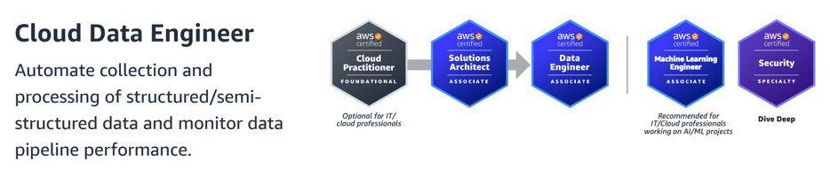

# 🚀 Complete Data Engineering Roadmap

**A comprehensive guide to becoming a data engineer with learning paths, essential technologies, certifications, and
resources**

---

## 📋 Table of Contents

- [🎯 Overview](#-overview)
- [🗺️ Learning Roadmaps](#️-learning-roadmaps)
- [🛠️ Technologies & Tools](#️-technologies--tools)
- [🎓 Certifications](#-certifications)
- [📚 Resources](#-resources)
- [📖 References](#-references)
- [💼 Interview Experiences](#-interview-experiences)

---

## 🎯 Overview

This repository provides a **complete data engineering roadmap** curated from industry experts, including a
comprehensive learning path, essential technologies, professional certifications, and valuable resources. Whether you're
starting your journey or looking to advance your career, this roadmap will guide you through every step of becoming a
proficient data engineer.

### ✨ What's Inside

- 📊 **Learning Roadmaps** - Step-by-step guides from industry experts
- 🔧 **Technology Stack** - Essential tools and frameworks organized by category
- 🏆 **Certifications** - Professional certifications from AWS, GCP, Azure, Snowflake, Databricks, and more
- 📖 **Resources** - Curated learning materials and references
- 🎯 **Best Practices** - Preferred technologies and recommended learning paths

---

## 🗺️ Learning Roadmaps

### 📺 Video Roadmaps

| Roadmap                                                                                         | Source                            |
|-------------------------------------------------------------------------------------------------|-----------------------------------|
| 🎥 [The ONLY Data Engineer Certifications You Need to Find a Job](https://youtu.be/pYYtYG6hU9w) | Jash Radia (Google Data Engineer) |
| 🎥 [God Tier Data Engineering Roadmap](https://youtu.be/WgCavqDntlQ)                            | Jash Radia (Google Data Engineer) |
| 📄 [Detailed Roadmap PDF](assets/data-engineering-roadmap-by-jash-radia)                        | Jash Radia                        |
| 🎥 [How I would learn Data Engineering](https://youtu.be/VSxF0bb-JH4)                           | Jayzern                           |

---

## 🛠️ Technologies & Tools

A curated list of essential technologies organized by category. **Bold** items indicate preferred/recommended options.

| Category                          | Technology/Tool                                                   | Status               |
|-----------------------------------|-------------------------------------------------------------------|----------------------|
| **💻 Programming Languages**      | **Python**, **SQL**, Java, Scala                                  | ⭐ Essential          |
| **⚡ Processing Frameworks**       | **Spark (PySpark)**, Flink, Apache Beam, AWS EMR                  | 🔥 Core              |
| **🗄️ Databases**                 | **PostgreSQL**, MySQL, **MongoDB**, Cassandra, DynamoDB, BigTable | 📊 Important         |
| **☁️ Data Warehouses**            | **Snowflake**, **BigQuery**, Redshift, Databricks                 | 🎯 Critical          |
| **🐧 Operating Systems**          | Linux                                                             | ✅ Required           |
| **☁️ Cloud Service Providers**    | **AWS**, **GCP**, Azure                                           | 🌟 Essential         |
| **🔄 Orchestration**              | **Airflow**, Prefect, Dagster                                     | 🚀 Must Learn        |
| **📡 Streaming**                  | **Kafka**, Kinesis, Pub/Sub, Flink                                | ⚡ Important          |
| **🐳 Containerization**           | **Docker**, **Kubernetes**                                        | 🎯 Industry Standard |
| **🏗️ Infrastructure as Code**    | **Terraform**, CloudFormation, Pulumi                             | 🔧 Recommended       |
| **🔄 CI/CD**                      | **GitHub Actions**, Jenkins, GitLab CI, SonarQube, SonarCloud     | ✅ Best Practice      |
| **📝 Version Control**            | Git                                                               | ✅ Essential          |
| **💾 Data Formats**               | **Parquet**, Avro, ORC, JSON                                      | 📦 Important         |
| **📊 Monitoring & Observability** | Datadog, **Prometheus**, Grafana, CloudWatch                      | 👁️ Critical         |
| **✅ Data Quality & Testing**      | Great Expectations, **dbt**                                       | 🎯 Best Practice     |
| **📨 Message Queues**             | **RabbitMQ**, Amazon SQS                                          | 🔄 Useful            |
| **🔀 ETL/Data Integration**       | **AWS Glue**                                                      | 🛠️ Important        |
| **📈 Data Visualization/BI**      | **Power BI**                                                      | 📊 Valuable          |

> **💡 Note:** Bold technologies indicate preferred options based on industry standards and market demand.

### 🎯 Technology Learning Priority

1. **🔥 Must Learn First:** Python, SQL, Linux, Spark, Airflow, Docker
2. **⭐ High Priority:** Cloud Platform (AWS/GCP/Azure), Data Warehouse (Snowflake/BigQuery), Kafka
3. **📚 Expand Knowledge:** Kubernetes, Terraform, dbt, Monitoring tools

---

## 🎓 Certifications

Professional certifications to validate your skills and advance your career. Organized by provider:

### ☁️ AWS (Amazon Web Services)

Source: [Plan your AWS Certification Journey](https://d1.awsstatic.com/training-and-certification/docs/AWS_certification_paths.pdf)

#### 🏆 AWS Certified Solutions Architect - Associate (Foundation)

**Certification:
** [AWS Certified Solutions Architect - Associate](https://aws.amazon.com/certification/certified-solutions-architect-associate/)

**Practice Exams:**

-
📝 [AWS Certified Solutions Architect Associate Practice Exams](https://www.udemy.com/course/aws-certified-solutions-architect-associate-amazon-practice-exams-saa-c03) -
Instructor: Jon Bonso

#### 🏆 AWS Certified Data Engineer - Associate (Core)

**Certification:** [AWS Certified Data Engineer - Associate](https://aws.amazon.com/certification/certified-data-engineer-associate/)

**Exam Prep:**

-
📚 [Exam Prep Plan: AWS Certified Data Engineer - Associate (DEA-C01)](https://skillbuilder.aws/learning-plan/QYZWVSMX4B/exam-prep-plan-aws-certified-data-engineer--associate-deac01--english/)

**Courses:**

- 🎥 [AWS Certified Data Engineer - Associate (DEA-C01)](https://youtu.be/6G0bLDIcO7Y) - 5 Hours | Complete
  preparation course by Johnny Chivers
-
🔗 [GitHub - Hands-on Practice](https://github.com/johnny-chivers/hands-on-aws-certified-data-engineer-associate-DEA-C01-Practice) -
Hands-on labs and practice exercises

**Articles & Guides:**

-
📖 [How I Prepared for the AWS Data Engineer Associate Exam](https://aws.plainenglish.io/how-i-prepared-for-the-aws-data-engineer-associate-exam-and-what-id-do-differently-3425365b46d4) -
Denis Burakov | First-hand experience and preparation tips

#### 🏆 AWS Certified Solutions Architect - Professional (Optional)

**Certification:** [AWS Certified Solutions Architect - Professional](https://aws.amazon.com/certification/certified-solutions-architect-professional/)

#### 📚 Common AWS Data Engineering Resources

| Resource                                  | Type                      | Link                                                                                                                              |
|-------------------------------------------|---------------------------|-----------------------------------------------------------------------------------------------------------------------------------|
| 📚 Data Engineering on AWS Learning Plans | Learning Plan (with labs) | [View Details](https://skillbuilder.aws/learning-plan/FYGBWGX6QJ/data-engineering-on-aws-learning-plans-includes-labs/7UPVWWCC45) |
| 📚 Data Engineering on AWS - Foundations  | Course                    | [View Details](https://skillbuilder.aws/learn/6BP61KB1FJ/data-engineering-on-aws--foundations/)                                   |
| 📚 A Day in the Life of a Data Engineer   | Course                    | [View Details](https://skillbuilder.aws/learn/U77D5JZK4B/a-day-in-the-life-of-a-data-engineer/PV2F9YXYPN)                         |

### 🌟 Apache Airflow

#### 🏆 Apache Airflow 3 Fundamentals (Mandatory)

**Certification:** [Apache Airflow 3 Fundamentals](https://academy.astronomer.io/certification-exam-apache-airflow-3-fundamentals)

**Courses:**

- 📚 **[Introduction to Apache Airflow in Python](https://campus.datacamp.com/courses/introduction-to-apache-airflow-in-python)**

**Practice Exams:**

- 📝 **[Apache Airflow Fundamentals Exam: mastering from zero](https://www.udemy.com/course/apache-airflow-interview-questions-for-mastering-from-zero/)**

#### 🏆 DAG Authoring (Airflow 3) (Optional)

**Certification:** [DAG Authoring (Airflow 3)](https://academy.astronomer.io/certification-exam-dag-authoring-airflow-3)

**Practice Exams:**

- 📝 **[Apache Airflow DAG Authoring exam questions](https://www.udemy.com/course/apache-airflow-dag-authoring-exam-questions/)**

### ⚡ Apache Spark

#### 🏆 Databricks Certified Associate Developer for Apache Spark (Mandatory)

**Certification:** [Databricks Certified Associate Developer for Apache Spark](https://www.databricks.com/learn/certification/apache-spark-developer-associate)

**Courses:**

- 📚 [Apache Spark™ Programming with Databricks](https://www.databricks.com/training/catalog/apache-spark-programming-with-databricks-134)
- 📚 [Udacity - Spark](https://www.udacity.com/course/learn-spark-at-udacity--ud2002)

**Practice Exams:**

- 📝 **[Databricks Certified Developer for Spark Practice Exams 2025](https://www.udemy.com/course/databricks-certified-developer-for-apache-spark-30-practice-exams/)**

### 🔷 Databricks

#### 🏆 Data Engineer Associate (Optional)

**Certification:** [Data Engineer Associate](https://www.databricks.com/learn/certification/data-engineer-associate)

**Courses:**

- 🎥 [Databricks Certified Data Engineer Associate - Preparation](https://www.udemy.com/course/databricks-certified-data-engineer-associate/) -
5 Hours

**Practice Exams:**

- 📝 [Practice Exams: Databricks Certified Data Engineer Associate](https://www.udemy.com/course/practice-exams-databricks-certified-data-engineer-associate/)
- 📝 [ExamCrest Data Engineer Associate free questions](https://examcrest.com/exam/databricks-dea/free-questions?utm_source=github&utm_campaign=thehimel-de-roadmap) - Free, no signup (full mock tests are paid)

#### 🏆 Data Engineer Professional (Optional)

**Certification:** [Data Engineer Professional](https://www.databricks.com/learn/certification/data-engineer-professional)

**Courses:**

- 🎥 [Databricks Certified Data Engineer Professional - Preparation](https://www.udemy.com/course/databricks-certified-data-engineer-professional/) -
4 Hours

**Practice Exams:**

- 📝 [Practice Exams: Databricks Data Engineer Professional](https://www.udemy.com/course/practice-exams-databricks-data-engineer-professional-k/)

### 🔵 Google Cloud Platform

#### 🏆 Associate Cloud Engineer (Foundation)

**Certification:** [Associate Cloud Engineer](https://cloud.google.com/learn/certification/cloud-engineer)

#### 🏆 Professional Data Engineer (Core)

**Certification:** [Professional Data Engineer](https://cloud.google.com/learn/certification/data-engineer)

**Courses:**

- 📚 [Cloud Data Engineer Professional Certificate](https://www.coursera.org/professional-certificates/gcp-data-engineering)

### 🔷 Microsoft Azure

#### 🏆 Fabric Data Engineer Associate (Core)

**Certification:** [Fabric Data Engineer Associate](https://learn.microsoft.com/en-us/credentials/certifications/fabric-data-engineer-associate/)

#### 🏆 Azure Solutions Architect Expert (Foundation) (Optional)

**Certification:** [Azure Solutions Architect Expert](https://learn.microsoft.com/en-us/credentials/certifications/azure-solutions-architect/)

### ❄️ Snowflake (Optional)

#### 🏆 SnowPro® Core

**Certification:** [SnowPro® Core (COF-C03)](https://learn.snowflake.com/en/certifications/snowpro-core-c03/)

**Practice Exams:**

- 📝 [ExamCrest SnowPro Core free questions](https://examcrest.com/exam/snowpro-core/free-questions?utm_source=github&utm_campaign=thehimel-de-roadmap) - Free, no signup (full mock tests are paid)

#### 🏆 SnowPro® Advanced: Data Engineer

**Certification:** [SnowPro® Advanced: Data Engineer](https://learn.snowflake.com/en/certifications/snowpro-advanced-dataengineer-C02/)

#### 📚 Common Snowflake Resources

- 🎥 [How to Learn Snowflake in 2025? (complete roadmap)](https://youtu.be/7nzDoH-SOLw)

## 💡 Notes

### 🎯 Certification Strategy

#### **Recommended Learning Path:**

1. **Foundation** → Start with cloud platform certifications (AWS/GCP/Azure)
2. **Specialization** → Then pursue data platform certifications (Snowflake/Databricks) based on your career goals
3. **Advanced** → Consider professional-level certifications after gaining experience

### 📌 Key Points

- **Cloud First:** Master one cloud platform (AWS, GCP, or Azure) before moving to specialized platforms
- **Hands-on Practice:** Combine certifications with real-world projects and hands-on labs
- **Career Alignment:** Choose certifications that align with your target roles and industry requirements
- **Continuous Learning:** Stay updated with new certifications and platform updates

## 📚 Resources

### 🌐 Essential Websites

- 🌟 [Start Data Engineering](https://www.startdataengineering.com/) - Comprehensive data engineering resources and
  guides

### 📖 Learning Path

* Master Python and SQL
* Learn one cloud service provider very good i.e. AWS.
* Get Certifications
  * Cloud
  * Airflow
  * Spark from Databricks

---

## 📖 References

### 📰 Articles & Guides

* Coursera - [5 Data Engineer Certifications: Which One Is Right For You?](https://www.coursera.org/articles/data-engineer-certification)
* DataCamp - [Which is the Best Snowflake Certification For 2025?](https://www.datacamp.com/blog/best-snowflake-certification)
* DataCamp - [Databricks Certifications In 2025: The Complete Guide](https://www.datacamp.com/blog/databricks-certifications)
* Skillsoft - [20+ Top-Paying IT Certifications for 2025](https://www.skillsoft.com/blog/top-paying-it-certifications)

## 💼 Interview Experiences

Real-world interview experiences from data engineers who successfully landed roles at top tech companies. Learn from
their journeys, preparation strategies, and insights.

### 🎥 Video Interviews

| Interview Experience                                                         | Creator    | Note                                     |
|------------------------------------------------------------------------------|------------|------------------------------------------|
| 🎤 [Google Data Engineer Interview Experience](https://youtu.be/2atyplJK8I8) | Data Depth | Leetcode Medium, Hackerrank Advanced SQL |
| 🎤 [Google Data Engineer Interview Experience](https://youtu.be/ZNg6cFcBISw) | Jash Radia |                                          |

> 💡 **Tip:** Watch these interviews to understand the interview format, types of questions asked, and how to prepare
> effectively for data engineering roles at top companies.

## Job Boards

* https://www.datacareer.de/categories/dataengineering/

---

## ⭐ Show Your Support

If this roadmap helped you in your data engineering journey, please consider giving it a ⭐ star!

---

## 📄 License

This project is open source and available under the [MIT License](LICENSE).

---

**Made with ❤️ for aspiring data engineers**

[⬆ Back to Top](#-complete-data-engineering-roadmap)
